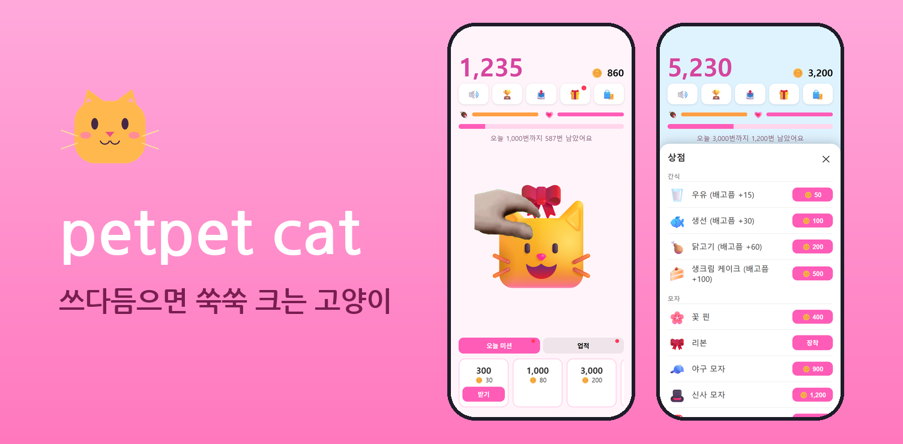

# 펫펫 (petpet cat)

쓰다듬으면 쑥쑥 크는 고양이 — 토스 앱 안에서 실행되는 **앱인토스(Apps in Toss) 미니앱 게임**입니다.
고양이를 터치(쓰다듬기)해서 코인을 모으고, 간식·모자·배경을 사서 키우는 터치 카운터 게임입니다.



## 기능

코드(`src/main.js`)에서 확인되는 기능입니다.

- **쓰다듬기 카운터**: 고양이를 터치하면 누적/오늘 터치 수가 올라가고, 손 GIF 이펙트·골골송·햅틱이 나옵니다. 초당 최대 12번까지만 인정합니다(오토클릭 방지).
- **진화**: 누적 터치 수에 따라 고양이 얼굴이 5단계(🐱 → 😺 → 😸 → 😻 → 🦁)로 바뀝니다.
- **오늘의 미션 / 업적**: 하루 터치 목표(매일 0시 초기화)와 누적 터치 업적을 달성하면 코인을 받습니다.
- **펫 돌봄**: 배고픔·기분 게이지가 시간이 지나면 줄어들고, 상점에서 간식을 사서 채웁니다.
- **상점**: 간식 4종, 모자 7종, 배경 8종을 코인으로 구매·장착합니다.
- **출석 보상**: 연속 출석일에 따라 코인이 늘어납니다(최대 7일 기준).
- **보상형 광고**: 미션/업적 보상을 광고 시청 후 2배로 받을 수 있습니다(광고를 지원하는 환경에서만 버튼 표시).
- **리더보드·공유**: 누적 터치 수를 토스 게임 리더보드에 제출하고, 공유 링크 메시지를 보낼 수 있습니다.
- **사용자별 저장**: 토스의 익명 사용자 키(`User.getAnonymousKey`)로 저장 데이터를 사용자별로 분리합니다. 토스 앱 밖(브라우저 개발 환경)에서는 `localStorage`로 대신 저장합니다.
- 효과음은 WebAudio로 직접 생성하고, 골골송만 `src/purr.mp3`를 사용합니다.

## 기술 스택

- Vite 8, 바닐라 JavaScript (프레임워크 없음)
- `@apps-in-toss/web-framework` 3.x (Storage, User, Device, Share, Game, 전면/보상형 광고)
- `@apps-in-toss/devtools` (개발용 Vite 플러그인)

## 실행 / 빌드

```bash
npm install
npm run dev      # 개발 서버 (vite dev, 기본 포트 5173)
npm run build    # vite build 후 ait build -> petpet-cat.ait 생성
npm run deploy   # ait deploy (앱인토스 콘솔 인증이 필요하며, 인증 정보는 저장소에 없습니다)
```

- 의존 패키지 중 일부(`@apps-in-toss/devtools` 등)는 Node.js 24 이상을 요구한다고 표시합니다(`engines`). Node 22에서도 `npm install`, `vite build`, `ait build`가 동작하는 것은 확인했지만, 가능하면 Node 24 이상을 쓰세요.
- 토스 앱 밖에서는 토스 SDK 기능(햅틱, 리더보드, 광고, 공유 등)이 동작하지 않아도 게임 자체는 실행되도록 예외를 무시합니다.

## 설정

별도의 환경변수나 비밀값은 사용하지 않습니다. 출시 전에 확인할 값만 아래에 정리합니다.

| 위치 | 값 | 설명 |
| --- | --- | --- |
| `apps-in-toss.config.ts` | `appName: 'petpet-cat'` | 앱인토스 콘솔에 등록한 `appName`과 같아야 합니다 |
| `src/main.js` | `APP_NAME` | 위 `appName`과 같은 값 (공유 링크 `intoss://` 경로에 사용) |
| `src/main.js` | `AD_ID = 'ait-ad-test-rewarded-id'` | **테스트용** 보상형 광고 ID. 출시 전에 콘솔에서 발급받은 ID로 교체해야 합니다 |
| `apps-in-toss.config.ts` | `brand.primaryColor` | 브랜드 색상 (`#FF91D5`) |

## 프로젝트 구조

```
index.html               화면 뼈대
src/main.js              게임 로직 전체 (터치, 진화, 미션/업적, 상점, 광고, 저장 등)
src/style.css            스타일
src/hand.gif, purr.mp3   쓰다듬는 손 이펙트, 골골송 음원
apps-in-toss.config.ts   앱인토스 설정 (appName, 브랜드, 권한)
vite.config.js           Vite 설정 (devtools 플러그인)
store-assets/            스토어 등록용 로고·스크린샷·썸네일 이미지
```

## 상태와 한계

- 앱인토스 출시를 목표로 만든 미니앱이며, 이 저장소의 코드만으로 심사 통과나 출시 완료를 보장하지는 않습니다.
- 광고 ID가 테스트 값이라 실제 광고 수익은 발생하지 않습니다.
- 점수·코인은 클라이언트에 저장되며 서버 검증이 없습니다(리더보드 제출 값도 클라이언트 값 그대로).
- 자동화 테스트는 없습니다.
